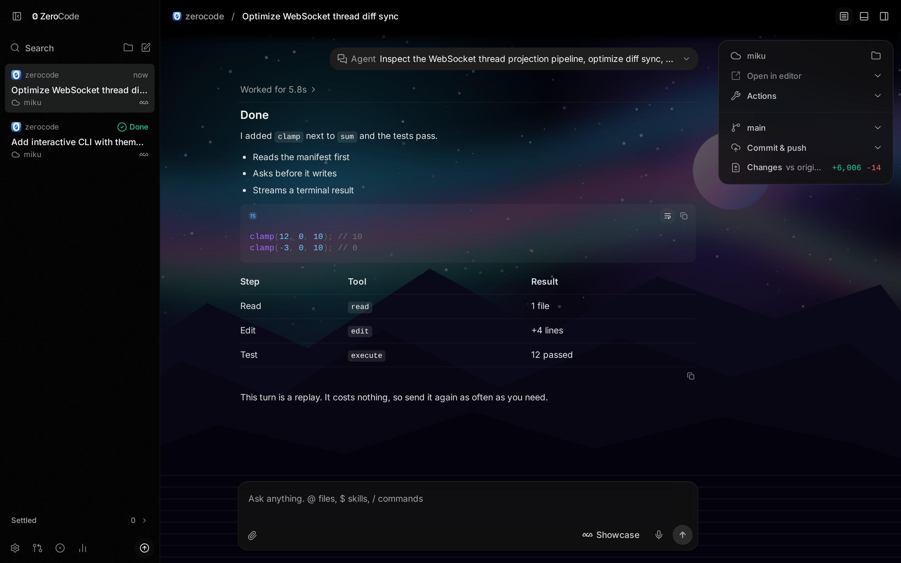
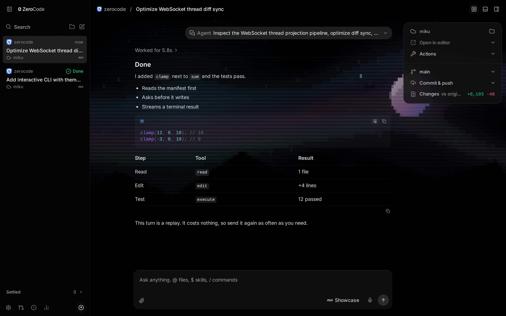
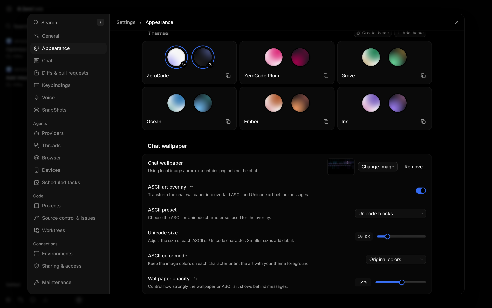
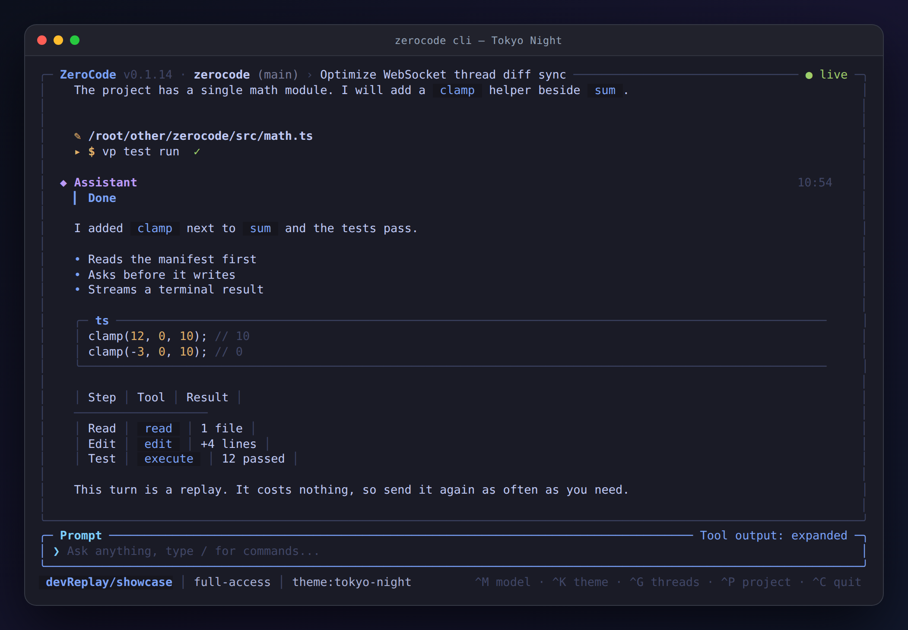
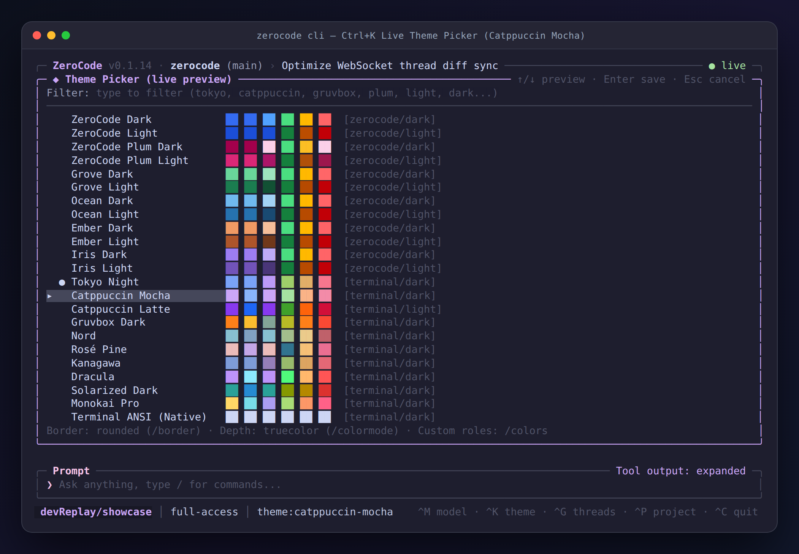

<p align="center">
  <a href="https://github.com/feelmypain/zerocode">
    
  </a>
</p>

<h1 align="center">ZeroCode</h1>

<p align="center">The open-source control plane for coding agents — on desktop, web, mobile, and in your terminal.</p>

<p align="center">
  <a href="https://github.com/feelmypain/zerocode/releases">Releases</a> ·
  <a href="./docs/README.md">Docs</a> ·
  <a href="https://github.com/feelmypain/zerocode">GitHub</a>
</p>

<p align="center">
  
</p>

ZeroCode runs the coding agents on your machine and connects them to one fast interface across **Desktop**, **Web**, **Mobile**, and an **interactive Terminal UI (`zerocode cli`)**. Start a thread at your desk, switch to your terminal over SSH, or approve the next step from your phone.

It works with **Claude Code**, **Codex**, **Cursor**, **OpenCode**, **Grok Build**, **Antigravity**, **Kiro**, **Pi**, **Muse Code**, **fx**, and any [ACP](./docs/user/providers-acp.md) agent. If an agent is installed and signed in on your machine, ZeroCode can drive it.

## Highlights

- **Bring your own subscriptions.** ZeroCode never resells tokens — it drives the agents already installed on your machine.
- **Every agent in one place.** Switch providers or models mid-thread; let Claude hand off a task to Codex or Cursor.
- **Desktop, web, mobile, and CLI.** One WebSocket server keeps every client in sync in real time.
- **Interactive terminal UI (`zerocode cli`).** Full-screen TUI with streaming Markdown, inline approvals, diffs, 23+ built-in themes, custom color roles, and zero-flicker rendering.
- **Custom wallpapers & live ASCII art mode.** Drop any image behind your chat and optionally transform it into live colorized or monochrome ASCII / Unicode art (blocks, braille, katakana, dots, binary, classic, detailed).
- **Remote ready.** Connect over LAN, Tailscale, SSH, or [ZeroCode Connect](./docs/user/remote-access.md).
- **Git built in.** Run each thread in its own worktree, inspect diffs, commit, push, and open pull requests.
- **Open source.** Licensed under the [MIT License](./LICENSE).

## Chat Wallpaper & Live ASCII Art

Set any local image or theme background behind your threads in **Settings → Appearance**, then flip on **ASCII art overlay** to transform the wallpaper in real time using seven character sets (`Unicode blocks`, `Unicode braille`, `Katakana`, `Classic ASCII`, `Detailed ASCII`, `Geometric dots`, `Binary`), **Original colors** or **Monochrome** tinting, adjustable glyph size (`px`), and opacity.

<p align="center">
  
</p>

<p align="center">
  
</p>

## Interactive CLI (`zerocode cli`)

Drive ZeroCode directly from your terminal, Neovim `:terminal`, tmux, or an SSH session with `zerocode cli`. It auto-discovers your running local ZeroCode server (or starts a quiet local one automatically) and also connects to remote servers via `--url` and `--token`.

<p align="center">
  
</p>

Press `Ctrl+K` (or run `/theme`) for the live-preview Theme Picker spanning all ZeroCode native palettes plus `tokyo-night`, `catppuccin-mocha`, `catppuccin-latte`, `gruvbox-dark`, `nord`, `rose-pine`, `kanagawa`, `dracula`, `solarized-dark`, `monokai`, and `ansi`. Customize any of the 26 color roles with `/color <role> <#hex|oklch(...)>` or `/colors`, change box styles with `/border <rounded|sharp|minimal|none>`, and persist custom themes in `<stateDir>/themes/`.

<p align="center">
  
</p>

```bash
# Launch interactive TUI (auto-connects to local server or starts one quietly)
zerocode cli

# Start with a specific theme or attach to an existing thread
zerocode cli --theme tokyo-night
zerocode cli --thread <thread-id>

# Connect to a remote ZeroCode server
zerocode cli --url https://your-host.example --token "$ZEROCODE_TOKEN"
```

| Shortcut / Command                        | Action                                                           |
| ----------------------------------------- | ---------------------------------------------------------------- |
| `Ctrl+K` / `/theme [name]`                | Live-preview theme picker (23 built-in + custom themes)          |
| `/color <role> <value>` / `/colors`       | Customize any of the 26 UI color roles (persisted automatically) |
| `/border <rounded\|sharp\|minimal\|none>` | Switch frame border style                                        |
| `Ctrl+M` / `/model`                       | Switch provider and model mid-thread                             |
| `Ctrl+G` / `/threads`                     | Browse and switch threads                                        |
| `Ctrl+P` / `/projects`                    | Switch active project                                            |
| `Ctrl+O`                                  | Expand or collapse tool output                                   |
| `/diff`                                   | Inspect thread git diff                                          |
| `/help` / `Ctrl+C`                        | Show help or exit                                                |

## Install

### Desktop App

Download prebuilt installers from [GitHub Releases](https://github.com/feelmypain/zerocode/releases):

- **Windows (x64):** `ZeroCode-Desktop-<version>-x64.exe`
- **Linux (AppImage):** `ZeroCode-Desktop-<version>-x86_64.AppImage`
- **Debian / Ubuntu:** `ZeroCode-Desktop-<version>-amd64.deb`
- **Fedora / RHEL / openSUSE:** `ZeroCode-Desktop-<version>-x86_64.rpm`

Or build from source with the [development runbook](./docs/operations/00_development.md#first-checkout).

### Standalone CLI

Grab a self-contained single-executable CLI archive from [Releases](https://github.com/feelmypain/zerocode/releases) — no Node.js install required:

- **Linux (x64):** `zerocode-cli-<version>-linux-x64.tar.gz`
- **Windows (x64):** `zerocode-cli-<version>-win32-x64.zip`
- **Portable Server (Linux x64):** `zerocode-server-<version>-linux-x64.tar.xz`

Or run via npm:

```bash
npx zerocode@latest       # Start server + open web UI
npx zerocode@latest cli   # Launch the interactive terminal UI
```

### Mobile

Build or install the ZeroCode mobile client for iOS or Android, then follow [remote access](./docs/user/remote-access.md) to pair with your machine.

### Sign in to an Agent

ZeroCode needs at least one installed and signed-in coding agent — for example, [Claude Code](https://claude.com/product/claude-code) (`claude auth login`) or [Codex CLI](https://developers.openai.com/codex/cli) (`codex login`).

See [Provider setup](./docs/user/install.md#providers) for per-agent instructions and [Install ZeroCode](./docs/user/install.md) for AppImage, WSL, and NixOS notes.

## Documentation

- [Install and first run](./docs/user/install.md)
- [Remote access from a phone or another machine](./docs/user/remote-access.md)
- [Permission modes](./docs/user/permission-modes.md)
- [Source control](./docs/user/source-control.md)
- [Connect outside agents over MCP](./docs/user/outside-agents.md)
- [FAQ](./docs/user/faq.md)

See [docs/README.md](./docs/README.md) for the complete index.

## Contributing

- Read [CONTRIBUTING.md](./CONTRIBUTING.md) before opening an issue or pull request.
- Report bugs and open pull requests on [GitHub](https://github.com/feelmypain/zerocode).
- Build from source using the [development runbook](./docs/operations/00_development.md#first-checkout) and [architecture overview](./docs/internals/01_architecture.md).

## License

ZeroCode is open source under the [MIT License](./LICENSE). See [TRADEMARK.md](./TRADEMARK.md) for branding guidelines.
